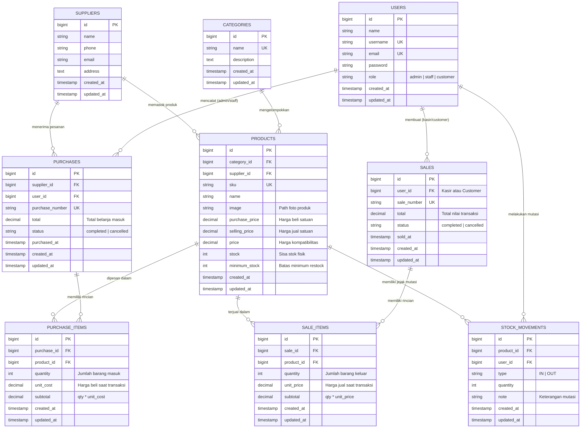

# Inventory & Sales Management System — Laravel UTS

Aplikasi web manajemen persediaan barang dan transaksi penjualan terintegrasi yang dibangun menggunakan **Laravel 12**, **MySQL/MariaDB**, **Eloquent ORM**, autentikasi berbasis peran (**Role-Based Access Control** dengan 3 Role: **Admin**, **Staff**, dan **Customer**), proteksi transaksi database atomik, dan validasi sisi server.

Proyek ini dikembangkan untuk memenuhi kriteria evaluasi **Ujian Tengah Semester (UTS) Web Programming 2**.

---

## 1. Project Overview

Aplikasi ini mengintegrasikan operasional internal bisnis distribusi dan layanan pemesanan mandiri oleh pelanggan:
- **Konsistensi Stok**: Stok otomatis bertambah saat pembelian dari pemasok (*stock-in*) dan berkurang saat transaksi penjualan di kasir atau pesanan pelanggan (*stock-out*).
- **Pencegahan Overselling**: Pesanan maupun penjualan langsung ditolak jika kuantitas melebihi stok yang tersedia.
- **Atomic Database Transactions**: Menggunakan `DB::transaction()` dan `lockForUpdate()` agar tidak ada transaksi atau perubahan stok yang setengah tersimpan jika terjadi error.
- **Otorisasi 3 Peran (Role-Based Access Control)**:
  1. **Admin / Owner**: Kontrol penuh master data, kelola user, laporan finansial, dan pembatalan transaksi.
  2. **Staff / Kasir**: Input pembelian barang masuk, input penjualan kasir, melihat daftar produk.
  3. **Customer / Pelanggan**: Registrasi akun mandiri, melihat katalog produk tersedia, membuat pesanan belanja online, dan melihat riwayat nota pesanan sendiri.

---

## 2. Requirements

- **PHP**: Versi 8.2 atau lebih baru.
- **Composer**: Dependency manager PHP.
- **Database**: MySQL / MariaDB (misalnya via XAMPP).
- **Web Server**: Apache / PHP Built-in server (`php artisan serve`).
- **Web Browser**: Chrome, Edge, atau Firefox.

---

## 3. Installation

Ikuti langkah-langkah instalasi bersih (*clean setup*) berikut:

1. **Clone repository:**
   ```bash
   git clone https://github.com/aisah250180056-prog/inventory-laravel-uts.git
   cd inventory-laravel-uts
   ```

2. **Instal dependensi Composer:**
   ```bash
   composer install
   ```

3. **Salin file environment:**
   ```powershell
   copy .env.example .env
   ```

4. **Generate application key:**
   ```bash
   php artisan key:generate
   ```

---

## 4. Environment Setup

Buka file `.env` dan sesuaikan konfigurasi database lokal Anda (misalnya default XAMPP MySQL):

```dotenv
APP_NAME=Laravel
APP_ENV=local
APP_KEY=base64:...
APP_DEBUG=true
APP_URL=http://localhost:8080

DB_CONNECTION=mysql
DB_HOST=127.0.0.1
DB_PORT=3306
DB_DATABASE=inventory_db
DB_USERNAME=root
DB_PASSWORD=
```

> **Catatan:** Pastikan database `inventory_db` sudah dibuat di MySQL (`CREATE DATABASE inventory_db;`) sebelum menjalankan migrasi.

---

## 5. Migration & Seeding

Jalankan migrasi untuk membuat seluruh tabel secara otomatis beserta seed data pengujian awal:

```bash
php artisan migrate --seed
```

Seeder akan otomatis mengisi:
1. Akun Demo Administrator (`admin@inventory.test`)
2. Akun Demo Staf Kasir (`staff@inventory.test`)
3. Akun Demo Customer Pelanggan (`customer@inventory.test`)
4. Data Master Kategori Barang
5. Data Master Pemasok (Supplier)
6. Data Master Produk lengkap dengan SKU, harga beli, harga jual, stok awal, dan stok minimum.

---

## 6. Akun Demo & Matriks Hak Akses (3 Peran)

| Peran (Role) | Username / Email | Password | Hak Akses Utama |
|---|---|---|---|
| **Admin / Owner** | `admin` / `admin@inventory.test` | `Admin123!` | Akses penuh: CRUD Master Data, Kelola Pengguna, Batalkan Transaksi & Pulihkan Stok, Dashboard Agregat, Laporan |
| **Staff / Kasir** | `staff` / `staff@inventory.test` | `Staff123!` | Operasional: Input Transaksi Pembelian (Stock-In), Input Penjualan Kasir (Stock-Out), Melihat Produk |
| **Customer** | `customer` / `customer@inventory.test` | `Customer123!` | Portal Pelanggan: Registrasi mandiri (`/register`), Katalog Produk Tersedia, Belanja/Pesan Barang, Lihat Riwayat Nota Sendiri |

> Pengunjung baru juga dapat mendaftar langsung sebagai **Customer** melalui tautan **[Daftar di sini](http://127.0.0.1:8080/register)** pada halaman Login.

---

## 7. Menjalankan Aplikasi

Jalankan server pengembangan Laravel:

```bash
php artisan serve --host=127.0.0.1 --port=8080
```

Buka peramban dan akses:
👉 **http://127.0.0.1:8080**

---

## 8. Entity Relationship Diagram (ERD) & Struktur Data

Diagram ERD lengkap dengan atribut, tipe data, serta kardinalitas relasi antar entitas:



### Penjelasan Relasi Eloquent (Slide 10 UTS):
- `Category hasMany Products` / `Product belongsTo Category`
- `Supplier hasMany Purchases` / `Purchase belongsTo Supplier`
- `Purchase hasMany PurchaseItems` / `PurchaseItem belongsTo Purchase`
- `PurchaseItem belongsTo Product` / `Product hasMany PurchaseItems`
- `User hasMany Sales` / `Sale belongsTo User`
- `Sale hasMany SaleItems` / `SaleItem belongsTo Sale`
- `SaleItem belongsTo Product` / `Product hasMany SaleItems`
- `Product hasMany StockMovements` / `StockMovement belongsTo Product`

> Dokumentasi detail kamus data dan penjelasan kardinalitas lengkap tersedia pada dokumen: **[`docs/ERD.md`](docs/ERD.md)**.

---

## 9. Fitur Aplikasi Sesuai Ketentuan PPT UTS

1. **Autentikasi & Multi-Role (3 Role)**:
   - Login menggunakan username atau email.
   - Pendaftaran akun Customer mandiri (`/register`).
   - Pembatasan rute server-side via Middleware & Gates (`can:admin`, `can:backoffice`).
   - Customer otomatis diarahkan ke antarmuka katalog dan dilarang mengakses menu internal toko (HTTP 403).
2. **Master Data**:
   - Kategori & Pemasok (CRUD terproteksi).
   - Produk: SKU unik, nama, kategori, pemasok, harga beli (*purchase_price*), harga jual (*selling_price*), stok, dan batas minimum stok (*minimum_stock*).
   - Larangan *hard-delete* jika produk memiliki riwayat transaksi (pembelian, penjualan, mutasi stok).
3. **Transaksi Pembelian (Stock-In)**:
   - Form dinamis multi-item.
   - Stok otomatis bertambah saat pembelian tersimpan.
   - Nomor transaksi unik otomatis (`PO-YYYYMMDDHHIISS-XXXX`).
   - Fitur pembatalan oleh Admin (menarik kembali stok jika mencukupi).
4. **Transaksi Penjualan (Stock-Out)**:
   - Form dinamis multi-item di kasir maupun di portal customer.
   - **Harga diambil dan divalidasi dari database**, bukan dari input browser.
   - Pengecekan stok aman dengan `Product::lockForUpdate()`.
   - Transaksi ditolak jika kuantitas melebihi stok yang tersedia.
   - Fitur pembatalan oleh Admin (mengembalikan stok ke gudang secara otomatis).
5. **Dashboard & Laporan**:
   - Total produk master dan total transaksi kumulatif.
   - Omset penjualan hari ini, bulan ini, dan total penjualan selesai.
   - Deteksi produk stok kritis (`stock <= minimum_stock`) dengan indikator peringatan restock.
   - Pencarian, filter tanggal transaksi, filter status (selesai/batal), dan pagination (`withQueryString()`).

---

## 10. Pengujian Otomatis (Automated Tests)

Semua skenario pengujian wajib telah diimplementasikan dalam test suite PHPUnit:
- Auth (Guest redirection & invalid login rejection)
- Validasi SKU unik dan harga negatif
- Pembelian berhasil menambah stok
- Penjualan kasir berhasil mengurangi stok
- Penjualan ditolak jika stok tidak mencukupi (tanpa perubahan data)
- Transaksi atomik (*rollback* jika satu item dalam multi-item gagal)
- Otorisasi server-side (Staff diblokir dari aksi Admin)
- Proteksi Customer (Customer diblokir dari modul internal toko)
- Pemesanan Customer mandiri berhasil mengurangi stok
- Registrasi Customer mandiri berhasil
- Pencarian dan filter kategori

Jalankan test suite menggunakan perintah:
```bash
php artisan test
```

---

## 11. Panduan Wawancara Pemilik Kode (Code Ownership Q&A)

Pertanyaan umum dosen saat evaluasi demo UTS dan penjelasannya:

1. **Mengapa `Sale` memiliki relasi `hasMany` ke `SaleItem`?**
   > Karena satu transaksi penjualan dapat berisi lebih dari satu jenis barang (*multi-item*). Tabel `sales` menyimpan header umum (nomor nota, tanggal, total, kasir/customer), sedangkan `sale_items` menyimpan detail per produk, kuantitas, dan harga saat transaksi terjadi.

2. **Di mana sistem memastikan stok tidak menjadi negatif?**
   > Di `SaleController.php` dan `CustomerController.php` di dalam `DB::transaction()`. Sebelum mengurangi stok, sistem melakukan `Product::lockForUpdate()->findOrFail(...)` dan memverifikasi `$product->stock < $quantity`. Jika tidak cukup, sistem melempar `ValidationException` sehingga transaksi dibatalkan sebelum stok tersentuh.

3. **Mengapa total penjualan dihitung di server?**
   > Untuk mencegah eksploitasi manipulasi input (*client tampering*). Jika total atau harga dihitung di browser, pihak tidak bertanggung jawab bisa mengubah nilai HTML / Request Payload untuk membeli barang berharga tinggi dengan harga murah. Server selalu mengambil harga asli dari database.

4. **Apa risiko jika pengurangan stok dilakukan di luar `DB::transaction`?**
   > Terjadi *data inconsistency* (data setengah tersimpan). Jika header nota penjualan berhasil disimpan tetapi penyimpanan item gagal atau terjadi error di tengah jalan, stok sudah terlanjur berkurang atau nota tercatat tanpa item barang.

5. **Bagaimana mencegah Staff atau Customer mengakses fungsi Admin melalui URL langsung?**
   > Menggunakan otorisasi server-side di rute (`routes/web.php`) melalui middleware `can:admin` dan `can:backoffice` serta pengecekan `abort_unless(...)` pada level Controller. Menyembunyikan tombol di Blade view hanya untuk antarmuka pengguna, bukan perlindungan keamanan.

6. **Apa fungsi `lockForUpdate()` pada transaksi penjualan?**
   > Mengunci baris produk di database (*pessimistic locking*) selama blok transaksi berjalan. Ini mencegah *race condition* atau *overselling* saat dua pengguna (misalnya kasir dan customer) membeli produk yang sama pada detik yang bersamaan.


---

## 12. Dokumentasi Visual & Screenshots Hasil Pengujian (Slide 20 UTS)

Seluruh tangkapan layar di bawah ini diambil langsung dari sistem yang berjalan dan tersimpan pada folder `screenshots/`:

### A. Tampilan & Master Data Produk
- `screenshots/01-dashboard-uts.png` — Dashboard ringkasan inventaris & metrik omset.
- `screenshots/02-crud-produk-uts.png` — Tabel master data produk dengan foto sembako & status stok.
- `screenshots/03-form-produk-uts.png` — Formulir tambah produk lengkap dengan upload foto & harga modal/jual.
- `screenshots/04-validasi-produk-uts.png` — Bukti validasi input server-side.
- `screenshots/05-produk-tersimpan-uts.png` — Detail produk tersimpan beserta riwayat mutasi stok.

### B. Transaksi & Operasional
- `screenshots/06-pembelian-uts.png` — Riwayat transaksi pembelian barang masuk (*Stock-In*).
- `screenshots/07-penjualan-uts.png` — Riwayat transaksi penjualan kasir (*Stock-Out*).
- `screenshots/08-riwayat-stok-uts.png` — Riwayat kartu mutasi stok barang (*Audit Trail*).
- `screenshots/09-laporan-uts.png` — Halaman laporan persediaan inventaris.

### C. Portal & Pemesanan Pelanggan (Customer)
- `screenshots/14-katalog-customer-uts.png` — Tampilan katalog kartu produk dengan visual foto HD bagi Customer.
- `screenshots/15-order-customer-uts.png` — Formulir pemesanan barang mandiri (*Self-Order*).

### D. Dokumentasi Teknis & Pengujian
- `screenshots/10-route-list-uts.png` — Daftar seluruh rute web Laravel terproteksi.
- `screenshots/11-blade-view-uts.png` — Struktur tampilan Blade Layout & View.
- `screenshots/12-migration-uts.png` — Skema migrasi tabel database terintegrasi.
- `screenshots/13-hasil-pengujian-uts.png` — Bukti kelulusan seluruh skenario uji otomatis (*16 passed, 44 assertions*).
