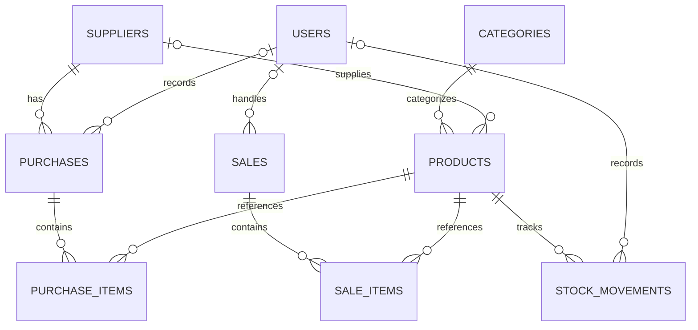

# Entity Relationship Diagram (ERD)

## Inventory Management System

ERD menggambarkan hubungan antarentitas dalam aplikasi Inventory Management System berbasis Laravel.

## Penjelasan Relasi

1. **Categories–Products:** satu kategori dapat memiliki banyak produk.
2. **Suppliers–Products:** satu pemasok dapat dikaitkan dengan banyak produk.
3. **Suppliers–Purchases:** satu pemasok dapat terkait dengan banyak transaksi pembelian.
4. **Users–Purchases:** pengguna dapat mencatat transaksi pembelian.
5. **Purchases–Purchase Items:** satu transaksi pembelian memiliki detail barang.
6. **Products–Purchase Items:** produk dapat muncul dalam banyak detail pembelian.
7. **Users–Sales:** pengguna dapat mencatat transaksi penjualan.
8. **Sales–Sale Items:** satu transaksi penjualan memiliki detail barang.
9. **Products–Sale Items:** produk dapat muncul dalam banyak detail penjualan.
10. **Products–Stock Movements:** satu produk dapat memiliki banyak catatan pergerakan stok.
11. **Users–Stock Movements:** pergerakan stok dapat dikaitkan dengan pengguna.

## Keterangan

- `PK` adalah primary key.
- `FK` adalah foreign key.
- `UK` adalah unique key.
- Relasi dengan pengguna bersifat opsional pada transaksi dan pergerakan stok karena kolom `user_id` mengizinkan nilai NULL.
- Produk mempunyai kolom `price`, `purchase_price`, `selling_price`, `stock`, dan `minimum_stock`.
- Tabel teknis Laravel seperti `sessions`, `cache`, dan `jobs` tidak ditampilkan dalam diagram utama.

Dokumentasi ini dibuat berdasarkan migration yang telah diperiksa. Struktur akhir tetap perlu dicocokkan dengan seluruh migration dan model aplikasi.

