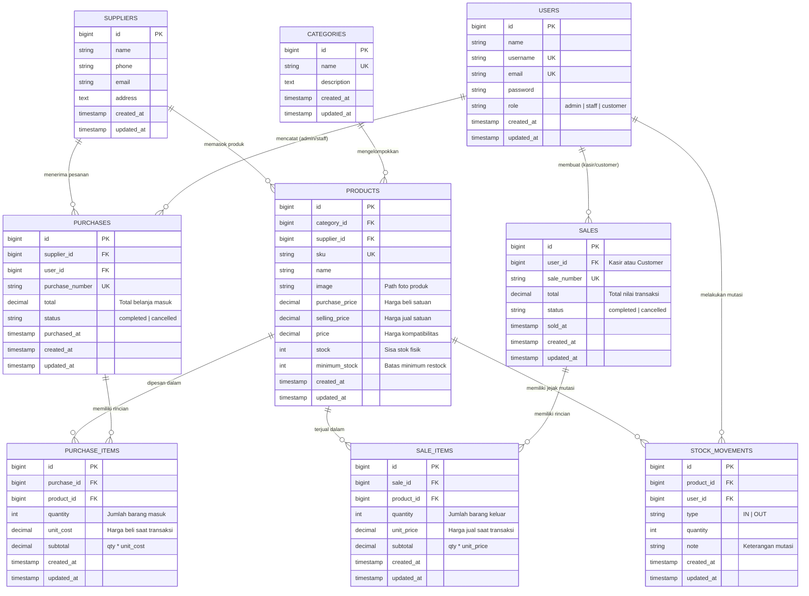

# Entity Relationship Diagram (ERD) Final

## Inventory & Sales Management System — Laravel UTS

Dokumentasi diagram hubungan antarentitas (ERD) terbaru dan terlengkap yang merefleksikan seluruh skema migrasi database, relasi Eloquent ORM, atribut kolom, kunci utama (*Primary Key*), kunci asing (*Foreign Key*), serta pembagian hak akses 3 peran (**Admin**, **Staff**, dan **Customer**).

---

## 1. Diagram ERD (Mermaid Notation)



---

## 2. Kamus Data / Skema Rinci Tabel

### 1. Tabel `users`
Menyimpan akun pengguna dengan pembatasan hak akses berbasis peran (RBAC).
- `id` (BIGINT, PK, Auto Increment)
- `name` (VARCHAR 100) — Nama lengkap pengguna.
- `username` (VARCHAR 50, UNIQUE) — Nama pengguna untuk login.
- `email` (VARCHAR 255, UNIQUE) — Alamat surel aktif.
- `password` (VARCHAR 255) — Kata sandi terenkripsi menggunakan Bcrypt.
- `role` (VARCHAR 50, Default: 'staff') — Peran akses: `admin`, `staff`, atau `customer`.
- `created_at`, `updated_at` (TIMESTAMP)

### 2. Tabel `categories`
Menyimpan kategori pengelompokan produk sembako, makanan, minuman, dan kebutuhan harian.
- `id` (BIGINT, PK, Auto Increment)
- `name` (VARCHAR 100, UNIQUE) — Nama kategori produk.
- `description` (TEXT, Nullable) — Deskripsi detail kategori.
- `created_at`, `updated_at` (TIMESTAMP)

### 3. Tabel `suppliers`
Menyimpan data rekanan pemasok barang masuk.
- `id` (BIGINT, PK, Auto Increment)
- `name` (VARCHAR 150) — Nama perusahaan / vendor pemasok.
- `phone` (VARCHAR 30, Nullable) — Nomor kontak telepon / WhatsApp.
- `email` (VARCHAR 150, Nullable) — Email kontak pemasok.
- `address` (TEXT, Nullable) — Alamat kantor / gudang pemasok.
- `created_at`, `updated_at` (TIMESTAMP)

### 4. Tabel `products`
Menyimpan master data barang/komoditas yang dikelola.
- `id` (BIGINT, PK, Auto Increment)
- `category_id` (BIGINT, FK -> `categories.id`, ON DELETE RESTRICT)
- `supplier_id` (BIGINT, FK -> `suppliers.id`, Nullable, ON DELETE SET NULL)
- `sku` (VARCHAR 50, UNIQUE) — Stock Keeping Unit unik (misal: `SBK-001`, `MNM-001`).
- `name` (VARCHAR 150) — Nama produk barang.
- `image` (VARCHAR 255, Nullable) — Nama file foto produk di `uploads/products/` atau tautan CDN gambar.
- `purchase_price` (DECIMAL 12,2, Default: 0) — Harga beli modal terakhir dari pemasok.
- `selling_price` (DECIMAL 12,2, Default: 0) — Harga jual resmi kepada pembeli.
- `price` (DECIMAL 12,2, Default: 0) — Kolom kompatibilitas harga jual.
- `stock` (INT, Default: 0) — Jumlah fisik barang tersedia di gudang.
- `minimum_stock` (INT, Default: 0) — Ambang batas peringatan stok kritis di dashboard.
- `created_at`, `updated_at` (TIMESTAMP)

### 5. Tabel `purchases` (Header Pembelian / Stock-In)
Menyimpan data nota pembelian barang dari pemasok.
- `id` (BIGINT, PK, Auto Increment)
- `supplier_id` (BIGINT, FK -> `suppliers.id`, ON DELETE RESTRICT)
- `user_id` (BIGINT, FK -> `users.id`, Nullable, ON DELETE SET NULL) — Petugas gudang penerima.
- `purchase_number` (VARCHAR 100, UNIQUE) — Nomor faktur pembelian unik (format: `PO-YYYYMMDDHHIISS-XXXX`).
- `total` (DECIMAL 14,2) — Total nilai pembelian (hasil penjumlahan subtotal seluruh item di server).
- `status` (VARCHAR 50, Default: 'completed') — Status transaksi: `completed` atau `cancelled`.
- `purchased_at` (TIMESTAMP) — Waktu fisik barang diterima.
- `created_at`, `updated_at` (TIMESTAMP)

### 6. Tabel `purchase_items` (Detail Item Pembelian)
Menyimpan rincian setiap produk dalam satu faktur pembelian (*multi-item*).
- `id` (BIGINT, PK, Auto Increment)
- `purchase_id` (BIGINT, FK -> `purchases.id`, ON DELETE CASCADE)
- `product_id` (BIGINT, FK -> `products.id`, ON DELETE RESTRICT)
- `quantity` (INT UNSIGNED, Min: 1) — Jumlah barang yang dibeli.
- `unit_cost` (DECIMAL 12,2) — Harga beli satuan saat transaksi dibuat.
- `subtotal` (DECIMAL 14,2) — Hasil kalkulasi `quantity * unit_cost`.
- `created_at`, `updated_at` (TIMESTAMP)

### 7. Tabel `sales` (Header Penjualan / Stock-Out)
Menyimpan data nota penjualan kasir maupun pesanan mandiri pelanggan (*Customer*).
- `id` (BIGINT, PK, Auto Increment)
- `user_id` (BIGINT, FK -> `users.id`, Nullable, ON DELETE SET NULL) — Kasir atau ID Customer yang berbelanja.
- `sale_number` (VARCHAR 100, UNIQUE) — Nomor nota unik (format kasir: `SO-...` atau pesanan customer: `ORD-...`).
- `total` (DECIMAL 14,2) — Total pembayaran (dihitung aman di server dari harga database).
- `status` (VARCHAR 50, Default: 'completed') — Status: `completed` atau `cancelled`.
- `sold_at` (TIMESTAMP) — Waktu transaksi penjualan diselesaikan.
- `created_at`, `updated_at` (TIMESTAMP)

### 8. Tabel `sale_items` (Detail Item Penjualan)
Menyimpan rincian setiap produk yang terjual dalam satu transaksi (*multi-item*).
- `id` (BIGINT, PK, Auto Increment)
- `sale_id` (BIGINT, FK -> `sales.id`, ON DELETE CASCADE)
- `product_id` (BIGINT, FK -> `products.id`, ON DELETE RESTRICT)
- `quantity` (INT UNSIGNED, Min: 1) — Jumlah barang yang dibeli.
- `unit_price` (DECIMAL 12,2) — Harga jual satuan resmi dari database saat transaksi.
- `subtotal` (DECIMAL 14,2) — Hasil perkalian `quantity * unit_price`.
- `created_at`, `updated_at` (TIMESTAMP)

### 9. Tabel `stock_movements` (Riwayat Kartu Stok / Audit Trail)
Mencatat setiap mutasi penambahan dan pengurangan stok secara kronologis.
- `id` (BIGINT, PK, Auto Increment)
- `product_id` (BIGINT, FK -> `products.id`, ON DELETE RESTRICT)
- `user_id` (BIGINT, FK -> `users.id`, Nullable, ON DELETE SET NULL)
- `type` (ENUM: 'IN', 'OUT') — Jenis mutasi (IN = stok masuk, OUT = stok keluar).
- `quantity` (INT UNSIGNED, Min: 1) — Jumlah unit mutasi.
- `note` (VARCHAR 255, Nullable) — Keterangan referensi (nomor nota penjualan, faktur pembelian, atau pembatalan).
- `created_at` (TIMESTAMP, Indexed) — Waktu mutasi terjadi.
- `updated_at` (TIMESTAMP)

---

## 3. Penjelasan Relasi Eloquent (Slide 10 UTS)

1. **`Category hasMany Products`** & **`Product belongsTo Category`**
   - Satu kategori membawahi banyak produk.
   - Kolom FK `category_id` berada di tabel `products`.

2. **`Supplier hasMany Purchases`** & **`Purchase belongsTo Supplier`**
   - Satu pemasok dapat menerima banyak transaksi pembelian stok.
   - Kolom FK `supplier_id` berada di tabel `purchases`.

3. **`Purchase hasMany PurchaseItems`** & **`PurchaseItem belongsTo Purchase`**
   - Satu nota pembelian terdiri dari banyak item barang (*one-to-many*).
   - Kolom FK `purchase_id` berada di tabel detail `purchase_items`.

4. **`User hasMany Sales`** & **`Sale belongsTo User`**
   - Satu pengguna (bisa Kasir atau Customer) dapat memiliki banyak riwayat transaksi penjualan.
   - Kolom FK `user_id` berada di tabel `sales`.

5. **`Sale hasMany SaleItems`** & **`SaleItem belongsTo Sale`**
   - Satu nota penjualan terdiri dari banyak barang (*multi-item*).
   - Kolom FK `sale_id` berada di tabel `sale_items`.

6. **`Product hasMany SaleItems`** & **`SaleItem belongsTo Product`**
   - Satu produk dapat terjual dalam berbagai transaksi yang berbeda.
   - Kolom FK `product_id` berada di tabel detail `sale_items`.

7. **`Product hasMany StockMovements`** & **`StockMovement belongsTo Product`**
   - Satu produk memiliki riwayat mutasi stok keluar-masuk yang dapat diaudit secara runtut.

### Mengapa Foreign Key Berada pada Tabel Detail (`purchase_items` & `sale_items`)?
Sesuai prinsip normalisasi basis data relasional (*3rd Normal Form*), sebuah transaksi pembelian atau penjualan dapat memiliki jumlah barang yang dinamis (1 item, 2 item, atau puluhan item). Menaruh foreign key di tabel detail memungkinkan relasi *one-to-many* tanpa redundansi data header (nomor nota, tanggal, kasir tidak perlu ditulis berulang kali untuk setiap barang).

### Menghindari Masalah N+1 Query:
Saat menampilkan daftar data produk beserta relasi kategori dan pemasoknya, Eloquent menggunakan *Eager Loading*:
```php
$products = Product::with(['category', 'supplier'])->paginate(10);
```
Dengan cara ini, Laravel hanya mengeksekusi 3 kueri SQL teroptimasi, bukan melakukan kueri berulang pada setiap baris data produk (*N+1 Problem*).
